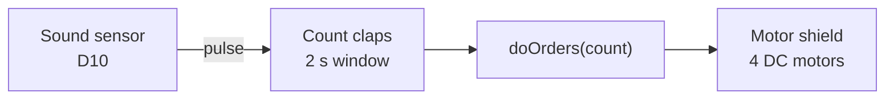

<h1 align="center">👏 Clap-Controlled Robot Car · Arduino Uno</h1>

Count the claps, pick the move: 1 forward · 2 back · 3 left · 4 right.

  
  
  

## Overview

- A digital sound sensor counts claps inside a **2-second window**.
- The count picks a move; the 4WD car runs it for 0.5–1.5 s, then stops.

| Claps | Action | Duration |
|:---:|---|:---:|
| 1 | Forward | 1.5 s |
| 2 | Backward | 1.5 s |
| 3 | Turn left | 0.5 s |
| 4 | Turn right | 0.5 s |

## How it works

## Hardware

| Part | Role |
|---|---|
| Arduino Uno | Controller |
| Digital sound sensor (D10) | Clap input |
| Adafruit Motor Shield v1 (`AFMotor`) | Drives 4 motors |
| 4 × BO motors, 4WD chassis | Movement |
| Battery pack | Power |

## Run it

1. Install the **Adafruit Motor Shield library (v1, `AFMotor.h`)** in the Arduino IDE.
2. Open `Arduino_ClapControlled__Car.ino`, select *Arduino Uno*, upload.
3. Tune the sound sensor's potentiometer until one clap gives one pulse.

## Status & known issues

| Issue | Effect | Fix |
|---|---|---|
| The sketch is wrapped in HTML `<strong>…</strong>` / ` ` tags (copied from a web page) | **Won't compile** | Delete the tags at the start and end |
| `Serial.begin()` is never called | Clap counts aren't printed | Add `Serial.begin(9600);` in `setup()` |
| `doOrders(apl)` checks the global `cont` instead of `apl` | Works by accident; fragile | Use the parameter |
| The code drives an Adafruit motor shield, but earlier docs said L298N | Wrong wiring if you follow the old docs | Use the shield, or rewrite the motor functions for L298N |
| Motor noise and room sounds trigger the sensor | False claps | Debounce, raise the threshold, shield the sensor |

**Credit:** the base sketch is by *DIY Burner* (credited in the file header).

## Roadmap

- [ ] Clean the sketch so it compiles; add serial debug
- [ ] Upload the circuit diagram and photos
- [ ] Noise filtering and clap-pattern recognition
- [ ] Bluetooth control as a fallback
